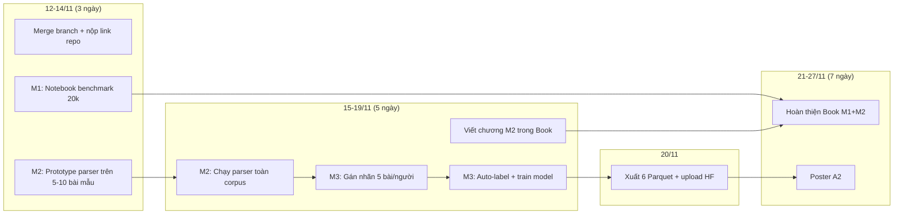
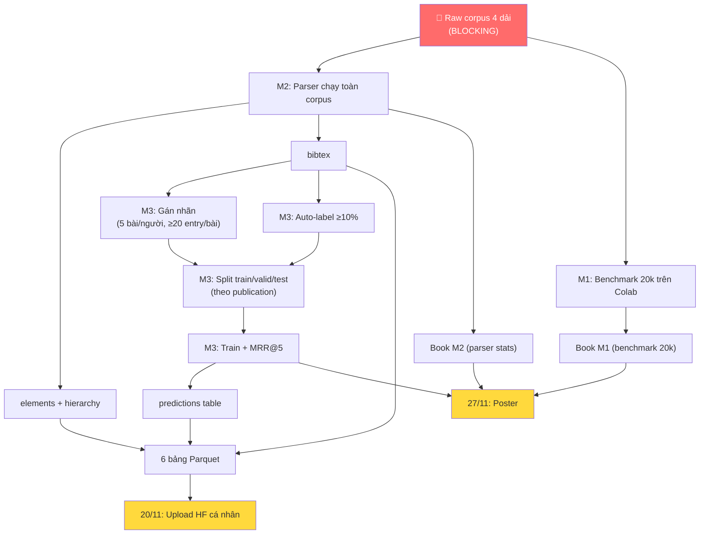

# Kế hoạch Đồ án Nhập môn KHDL — arXiv Project

## Bối cảnh
Nhóm 4 người (Khôi 🎯, Khánh, Bảo, Phát) làm 3 milestone trên pipeline arXiv: crawl → parse LaTeX → match citation.
Hôm nay 12/11/2026. Ba mốc nộp: **14/11** (link repo), **20/11** (HF dataset cá nhân), **27/11** (poster + chốt Book + commit cuối).

---

## Phần A — KẾT QUẢ AUDIT

### A1. Tổng quan repo

| Repo | Nội dung | Trạng thái |
|:--|:--|:--|
| [arXiv-Project](file:///home/domi1712/Documents/Code/IntroToDS_Project/arXiv-Project) | Source code crawler (8 module Python + tests + benchmarks) | HEAD ở branch `feat/parallel-experiment`, cách `main` 6 commits. Chưa merge. |
| [arXiv-Report](file:///home/domi1712/Documents/Code/IntroToDS_Project/arXiv-Report) | Jupyter Book M1 (4 file: intro, implementation, statistics, performance) | Trên `main`. Có GitHub Actions deploy. |

### A2. Dữ liệu đã crawl (chỉ dải Khôi trên local)

| Chỉ số | Giá trị | Ghi chú |
|:--|:--|:--|
| Dải ID Khôi | `2506.05788` → `2506.10787` | 5.000 bài, đủ 100% |
| Tổng bài trên disk | **5.000** | Không có empty metadata |
| Tổng version trên disk | **8.253** | Khớp CSV |
| PDF-only versions | 521 | Trên tổng 8.253 |
| Papers không có ref từ S2 | 301 | references.json = `[]` |
| Kích thước corpus (chỉ .tex/.bib) | ~2.8 GB (dải Khôi) | |

### A3. Dải của 3 thành viên còn lại (từ CSV trong Report)

| Thành viên | Dải ID | Lines CSV (≈ versions) | Trạng thái raw |
|:--|:--|:--|:--|
| Bảo (?) | `2503.01914` → `2503.06913` | 8.206 | Log `crawl_bao.log` có **280 lần "Defaulting to v1"** → cần kiểm tra lại |
| Khánh (?) | `2503.21914` → `2504.02522` | 7.870 | Không có raw trên local, chỉ có CSV |
| Phát (?) | `2505.10666` → `2505.15665` | 8.584 | Không có raw trên local, chỉ có CSV |

> [!CAUTION]
> **Chỉ có raw corpus của dải Khôi trên máy.** Dải của Khánh, Bảo, Phát hoàn toàn không có raw trên local (`/home/domi1712`) — chỉ có summary CSV trong arXiv-Report. Cần hỏi nhóm ngay: raw nằm ở đâu (Google Drive? máy cá nhân?).

### A4. Vấn đề "Defaulting to v1" trong log Bảo

File [crawl_bao.log](file:///home/domi1712/Documents/Code/IntroToDS_Project/Documents/crawl_bao.log) ghi **280 dòng** `"Discovery query unavailable (API rate limit). Defaulting to v1 to proceed with download."`. Nghĩa là:
- 280 bài trong dải Bảo có thể bị **mất version** (chỉ crawl v1 dù bài có nhiều version hơn).
- Metadata của chúng sẽ ghi `versions: ["xxxv1"]` vì code fallback.
- **Cần re-crawl discovery cho 280 bài này** trước khi chạy M2/M3.

### A5. Schema lệch so với đề bài

| Vấn đề | Chi tiết | Cần xử lý |
|:--|:--|:--|
| **`revised_dates` chỉ lưu 1 mốc** | Đề yêu cầu `list of strings`. Dải Khôi: 2.184 bài có đúng 1 date, 2.816 bài rỗng, **0 bài có >1 date**. arXiv API chỉ trả `updated` (1 mốc cuối). | Nếu bài có 5 version → metadata lẽ ra cần 4 revised_dates. Cần quyết định: dùng danh sách `versions` để suy ngược, hoặc để trống và ghi chú. |
| **`versions` (extra field)** | Không nằm trong schema đề. 5.000/5.000 bài đều có. | Bỏ khi xuất Parquet bảng `papers`. Giữ internal để M2/M3 biết cần parse bao nhiêu version. |
| **`ref_venue` (extra field)** | references.json ghi thêm `ref_venue`. Đề bảng `references` không có cột này. | Bỏ khi xuất Parquet. |
| **`references` chứa cả ref không có arXiv ID** | Hiện tại references.json giữ tất cả. Đề yêu cầu bảng `references` "keeping the arXiv-keyed references only". | Lọc `ref_arxiv_id IS NOT NULL` khi xuất. |

### A6. Rate limit trong code vs. report

| Endpoint | Code thực tế | Report/README |
|:--|:--|:--|
| arXiv | `3.5s` ([utils.py:90](file:///home/domi1712/Documents/Code/IntroToDS_Project/arXiv-Project/src/utils.py#L90)) | implementation.md ghi "3.0-second delay" |
| S2 (trong `utils.py`) | `3.0s` ([utils.py:91](file:///home/domi1712/Documents/Code/IntroToDS_Project/arXiv-Project/src/utils.py#L91)) | Nhưng... |
| S2 (bị override trong `crawler.py`) | Parallel: `1.0s` (có key) / `2.5s` (không key) ([crawler.py:695-697](file:///home/domi1712/Documents/Code/IntroToDS_Project/arXiv-Project/src/crawler.py#L695)) | Report ghi "1.0s with key, 2.5s without" |
| Sequential fallback | `3.0s` hard sleep ([crawler.py:597](file:///home/domi1712/Documents/Code/IntroToDS_Project/arXiv-Project/src/crawler.py#L597)) | |

> [!WARNING]
> Report ghi `3.0s` cho arXiv nhưng code dùng `3.5s`. **Phải đồng bộ.** Report nên ghi đúng số thật trong code.

### A7. Vấn đề benchmark 5 worker vs. đề

Đề yêu cầu: *"one connection at a time, ≥3s between successive calls"* (arXiv API etiquette). Chạy 5 download worker song song **vẫn hợp lệ nếu** tất cả workers chia sẻ cùng 1 rate limiter 3.5s → tại một thời điểm chỉ có 1 request thực sự đang chờ API.

Kiểm tra code: `arxiv_rate_limiter` là singleton dùng chung → **hợp lệ**. Nhưng report cần giải thích rõ ràng hơn: workers overlap CPU/IO, nhưng network requests vẫn tuần tự theo rate limiter.

### A8. Trạng thái Report (arXiv-Report)

| File | Trạng thái |
|:--|:--|
| [intro.md](file:///home/domi1712/Documents/Code/IntroToDS_Project/arXiv-Report/milestone1/intro.md) | ✅ Có |
| [implementation.md](file:///home/domi1712/Documents/Code/IntroToDS_Project/arXiv-Report/milestone1/implementation.md) | ⚠️ Khá đầy đủ nhưng rate limit mô tả sai (ghi 3.0s thay vì 3.5s). |
| [statistics.ipynb](file:///home/domi1712/Documents/Code/IntroToDS_Project/arXiv-Report/milestone1/statistics.ipynb) | ✅ Có, dùng CSV của 4 dải |
| [performance.ipynb](file:///home/domi1712/Documents/Code/IntroToDS_Project/arXiv-Report/milestone1/performance.ipynb) | ⚠️ Chỉ benchmark trên 100 bài (baseline + parallel). Chưa có benchmark 20.000 bài end-to-end. |
| Chương M2 | ❌ Chưa có |
| `myst.yml` | Chỉ cấu hình M1 |

### A9. Branch chưa merge

`arXiv-Project` HEAD ở `feat/parallel-experiment` (6 commits trước `main`). Các features quan trọng (profiler, parallel pipeline, ablation suite) **chưa merge vào main**. Branch `feat/benchmark-and-parallel-opt` đã push remote nhưng cũng chưa merge.

### A10. Số liệu từ ChatGPT cần kiểm chứng

| Claim | Kiểm chứng | Kết quả |
|:--|:--|:--|
| 20.000 bài | CSV tổng: 8206 + 7870 + 8584 + 8254 lines ≈ 32.914 version-rows | ✅ Khớp ~32.910 (đã trừ header) |
| 32.910 version | Tổng 4 CSV trừ header = 32.910 | ✅ |
| 411.724 reference | Chưa kiểm tra (cần đếm từ tất cả references.json) | ❓ Chỉ có raw Khôi |
| 100 bài tuần tự 22.36 phút | Trong performance.ipynb baseline_colab_stats.json | Cần verify |
| 100 bài 5 worker 9.49 phút | Trong parallel_colab_stats.json | Cần verify |

---

## Phần B — NHỮNG VIỆC CẦN LÀM TRƯỚC KHI LÊN KẾ HOẠCH

> [!IMPORTANT]
> **Câu hỏi chặn đầu (blocking questions) — cần hỏi nhóm ngay hôm nay:**

1. **Raw corpus 3 dải còn lại ở đâu?** Khánh, Bảo, Phát mỗi người giữ raw ở đâu (Drive? máy cá nhân?)? Cần link hoặc cách truy cập. Nếu mất → phải crawl lại.
2. **Dải Bảo có 280 bài bị fallback v1** — Bảo đã chạy lại discovery cho 280 bài này chưa?
3. **Phát khi nào quay lại?** Cần biết để chia việc.
4. **Repo code nên merge `feat/parallel-experiment` → `main` trước 14/11?** Hiện main thiếu profiler, parallel pipeline, ablation.

---

## Phần C — KẾ HOẠCH THỰC HIỆN

### Tổng quan timeline

---

### Mốc 1: 12–14/11 — Setup & nộp link repo

#### Khôi (điều phối + benchmark)
| # | Việc | Chi tiết | Chặn bởi |
|:--|:--|:--|:--|
| K1 | **Hỏi nhóm ngay** | Vị trí raw 3 dải, Phát bao giờ quay, branch merge | — |
| K2 | **Merge branches vào main** | `feat/parallel-experiment` → `main`. Kiểm tra CI pass. | — |
| K3 | **Fix rate limit report** | Sửa implementation.md: arXiv = 3.5s, S2 = 3.0s default / 1.0s-2.5s parallel | — |
| K4 | **Nộp link repo trước 14/11 23:59** | Kiểm tra repo public, README đủ lệnh cài + chạy | K2 |
| K5 | **Chọn 5-10 bài mẫu cho M2** | Bài có ≥2 version, có .bib/.bibitem, có multi-file .tex. Gửi cho Khánh + Bảo. | Raw Khôi ✅ |
| K6 | **Thiết kế notebook benchmark 20k** | Chia 4 dải × 50 lô/dải, mount Drive, checkpoint theo lô, resume khi Colab ngắt, log phiên | — |

#### Khánh (parser nội dung)
| # | Việc | Chi tiết | Chặn bởi |
|:--|:--|:--|:--|
| Kh1 | **Báo link raw của mình** | Để nhóm biết raw nằm đâu | — |
| Kh2 | **Viết prototype parser trên 1 bài mẫu** | Tìm `\documentclass`, follow `\input`/`\include`, dựng cây section→subsection→sentence. Xuất mẫu elements + hierarchy cho 2 version. | K5 |
| Kh3 | **Xử lý sentence splitting** | Không vỡ ở `Fig. 1`, `et al.`, `i.e.`, số thập phân, URL, công thức inline | Kh2 |

#### Bảo (parser BibTeX + matching prep)
| # | Việc | Chi tiết | Chặn bởi |
|:--|:--|:--|:--|
| B1 | **Báo link raw + kiểm tra 280 bài fallback v1** | Re-run discovery cho 280 bài bị thiếu version | — |
| B2 | **Viết prototype BibTeX parser** | Đọc .bib, parse `\bibitem`, xuất bảng bibtex mẫu. Trên cùng bài với Khánh. | K5 |
| B3 | **Thống nhất interface với Khánh** | Key = `{arxiv_id}#{element_id}`, bảng đổi citation_key giữa version | Kh2, B2 |

#### Phát (khi quay lại)
| # | Việc | Chi tiết |
|:--|:--|:--|
| P1 | **Báo raw của mình** | Link/path |
| P2 | **Nhận bàn giao** | Doc + notebook chạy thử |

---

### Mốc 2: 15–19/11 — Chạy full pipeline M2 + M3

#### Khôi
| # | Việc | Chi tiết | Chặn bởi |
|:--|:--|:--|:--|
| K7 | **Chạy benchmark 20k trên Colab** | Chia 4 phiên (1 phiên/dải), checkpoint + log. Nhờ Khánh/Bảo/Phát chạy dải của mình. | K6, raw 4 dải |
| K8 | **M3: Viết baseline matching model** | Logistic regression trên features: title similarity (TF-IDF cosine), author last name overlap, year delta. Nhận bibtex + references từ Bảo. | B2, Bảo giao bibtex |
| K9 | **M3: Gán nhãn 5 bài thủ công** | ≥20 entry/bài, ≥100 entry tổng phần Khôi | parser M2 chạy xong 1 phần |
| K10 | **M3: Train + eval MRR@5** | Split theo publication: test 4 bài hand + 4 bài auto, valid tương tự | K8, K9, labels từ nhóm |

#### Khánh
| # | Việc | Chi tiết | Chặn bởi |
|:--|:--|:--|:--|
| Kh4 | **Chạy parser toàn corpus** | Tất cả version, ghi nhận PDF-only = empty. Benchmark parser trên Colab CPU. | Kh2 hoàn thiện |
| Kh5 | **Gán nhãn 5 bài** | ≥20 entry/bài | Parser chạy xong vài bài |
| Kh6 | **Viết chương M2 trong Book** | Giải thích parser, thống kê coverage, dedup stats, benchmark | Kh4 |

#### Bảo
| # | Việc | Chi tiết | Chặn bởi |
|:--|:--|:--|:--|
| B4 | **Chạy BibTeX parser + dedup toàn corpus** | Gộp entry trùng giữa version, bảng đổi citation key → sửa `\cite` | B2 hoàn thiện |
| B5 | **Auto-labeler heuristic** | Regex/cosine similarity title matching → gán nhãn ≥10% bài ngoài pool thủ công (≥1.998 bài nếu pool = 20) | B4 |
| B6 | **Gán nhãn 5 bài** | ≥20 entry/bài | B4 |

#### Phát
| # | Việc | Chi tiết |
|:--|:--|:--|
| P3 | **Chạy benchmark dải mình** | Colab CPU |
| P4 | **Gán nhãn 5 bài** | ≥20 entry/bài |

---

### Mốc 3: 20/11 23:59 — Nộp HF Dataset

| Việc | Ai | Chi tiết |
|:--|:--|:--|
| **Xuất 6 bảng Parquet** | Tất cả | `papers`, `references` (chỉ ref có arXiv ID), `elements`, `hierarchy`, `bibtex`, `predictions`. Schema phẳng. |
| **Lọc schema** | Khôi | Bỏ `versions` khỏi papers, bỏ `ref_venue` khỏi references, fix `revised_dates`. |
| **Upload HF cá nhân** | Mỗi người | Trích dải ID → 6 folders Parquet + README.md card |
| **Verify** | Mỗi người | Mở link HF, đọc 6 bảng, check schema khớp đề |

> [!IMPORTANT]
> **Mỗi người phải tự nộp link HF cá nhân trước 20/11 23:59.** Không nộp chung.

### Schema Parquet cần xuất

**papers** (M1):
| Column | Type | Note |
|:--|:--|:--|
| arxiv_id | string, non-null | |
| title | string | |
| authors | list[string] | |
| submission_date | string (ISO) | |
| revised_dates | list[string] | Cần sửa: hiện chỉ có 1 date hoặc rỗng |
| venue | string, nullable | |

**references** (M1):
| Column | Type | Note |
|:--|:--|:--|
| arxiv_id | string, non-null | Bài trích dẫn |
| ref_arxiv_id | string, non-null | ⚠️ CHỈ GIỮ ref có arXiv ID |
| ref_title | string | |
| ref_authors | list[string] | |
| ref_submission_date | string | |
| ref_s2_id | string | |

**elements** (M2):
| Column | Type |
|:--|:--|
| element_id | string, non-null |
| arxiv_id | string, non-null |
| kind | string |
| content | string |

**hierarchy** (M2):
| Column | Type |
|:--|:--|
| arxiv_id | string, non-null |
| version | int |
| element_id | string, non-null |
| parent_id | string, non-null |

**bibtex** (M2):
| Column | Type |
|:--|:--|
| arxiv_id | string, non-null |
| citation_key | string, non-null |
| entry_type | string |
| title | string |
| authors | list[string] |
| year | int, nullable |
| doi | string |
| journal | string |
| url | string |

**predictions** (M3):
| Column | Type |
|:--|:--|
| arxiv_id | string, non-null |
| partition | string (`train`/`valid`/`test`) |
| citation_key | string, non-null |
| groundtruth_arxiv_id | string, nullable |
| cand_1 … cand_5 | string, nullable |

---

### Mốc 4: 21–27/11 — Hoàn thiện & nộp poster

| Việc | Ai | Chi tiết |
|:--|:--|:--|
| Cập nhật Book M1 | Khôi | Thêm benchmark 20k vào performance.ipynb |
| Viết Book M2 | Khánh | Thêm chương M2: parser logic, stats, benchmark |
| Poster A2 .pptx | Cả nhóm | 1 slide dọc A2. Nội dung: pipeline overview, crawl stats, dedup stats, matching MRR@5, feature analysis |
| Chốt commit | Khôi | Review code quality, docstrings, README |

---

## Phần D — QUYẾT ĐỊNH CẦN ĐƯA RA NGAY

> [!IMPORTANT]
> Khôi cần quyết định/thảo luận nhóm về các điểm sau:

### D1. `revised_dates` — lấy từ đâu?
- **Phương án A**: Dùng danh sách `versions` (đã có), lấy timestamp từ arXiv API cho từng version → list of dates. Cần thêm 1 API call per version.
- **Phương án B**: Chấp nhận chỉ có 1 date (`updated`) hoặc rỗng. Ghi chú trong dataset card. Rủi ro: đề yêu cầu "list of strings".
- **Đề xuất**: Phương án A nếu kịp, B nếu cận deadline.

### D2. Benchmark 20k — chạy lại toàn bộ hay dùng data đã có?
- Q&A thầy: "benchmark cần trên **toàn bộ** tập dữ liệu nhóm được giao".
- Nhưng Q&A cũng cho phép "chia nhiều phiên Colab, giữ log từng phiên".
- chatgpt_conversation gợi ý chỉ cần benchmark mẫu + ngoại suy → **SAI** so với Q&A.
- **Đề xuất**: Chạy lại end-to-end trên Colab cho toàn bộ 20k, chia phiên, checkpoint, log bền vững.

### D3. Benchmark dùng cấu hình nào?
- 5 worker có thể gây hiểu nhầm. Nhưng code rate limiter shared → hợp lệ.
- **Đề xuất**: Dùng cấu hình tốt nhất (parallel), giải thích rõ trong report rằng rate limiter là shared, tại 1 thời điểm chỉ 1 request.

### D4. Data ~10-11 GB lưu ở đâu cho M2/M3?
- Raw .tex/.bib toàn bộ 4 dải ước ~11 GB. Google Drive free = 15 GB.
- **Đề xuất**: Mỗi người giữ raw dải mình trên Drive cá nhân hoặc máy. Notebook Colab mount Drive, đọc từ đó. Không cần gom 1 chỗ.

### D5. Branch merge strategy
- `feat/parallel-experiment` có profiler + parallel pipeline + ablation.
- **Đề xuất**: Merge vào main ngay hôm nay, trước khi nộp link 14/11.

---

## Phần E — CHECKLIST VIỆC CẦN LÀM NGAY HÔM NAY (12/11)

- [ ] **Khôi**: Hỏi nhóm vị trí raw 3 dải (chặn toàn bộ M2/M3)
- [ ] **Khôi**: Merge `feat/parallel-experiment` → `main`, push
- [ ] **Khôi**: Sửa rate limit trong implementation.md (3.5s thay vì 3.0s)
- [ ] **Khôi**: Chọn 5-10 bài mẫu từ dải mình, gửi Khánh + Bảo
- [ ] **Khánh**: Báo link raw dải mình
- [ ] **Bảo**: Báo link raw + kiểm tra 280 bài fallback v1
- [ ] **Phát**: Báo khi nào quay lại + link raw
- [ ] **Khánh**: Bắt đầu prototype parser trên 1 bài mẫu
- [ ] **Bảo**: Bắt đầu prototype BibTeX parser trên cùng bài

---

## Phần F — DEPENDENCY GRAPH

> [!CAUTION]
> **Critical path**: Raw corpus → M2 parser → bibtex → labels → model → predictions → Parquet → HF upload (20/11).
> Nếu raw không có trước 13/11, deadline 20/11 sẽ rất căng.
